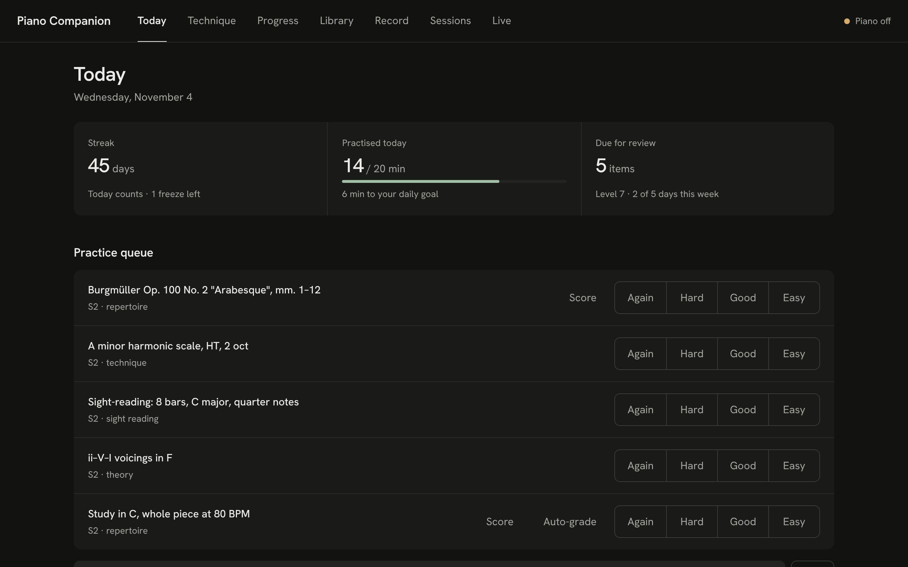
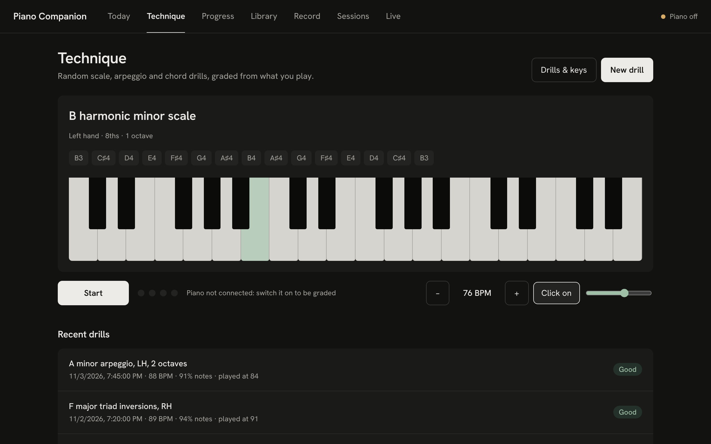
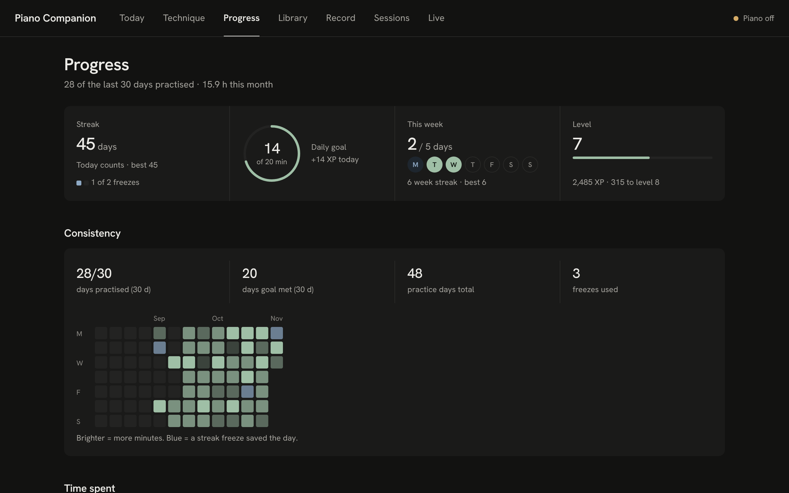
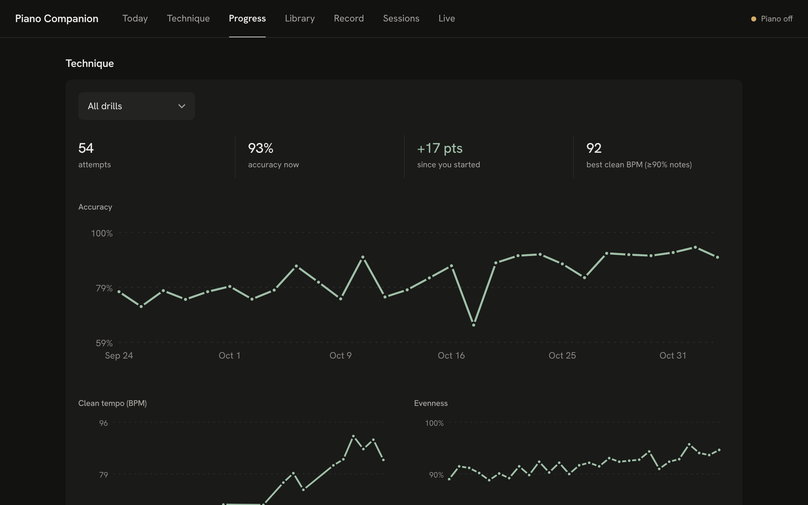
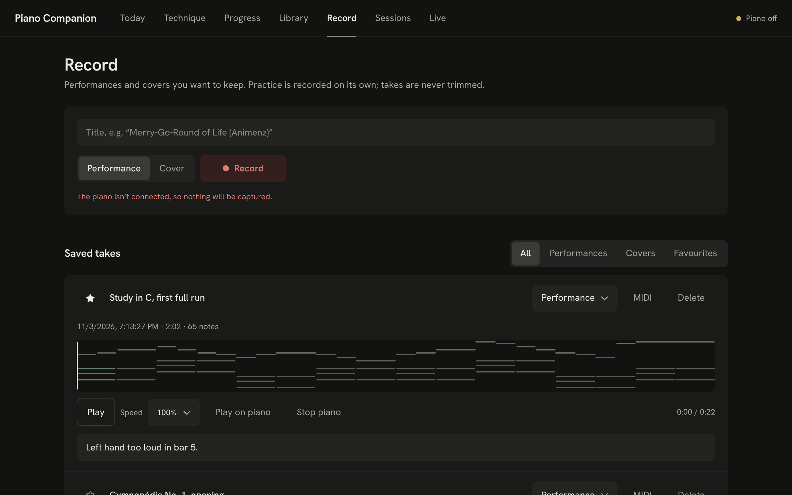
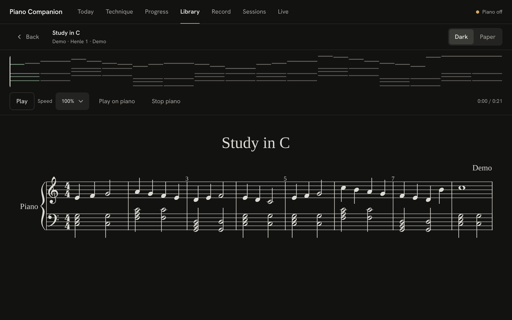

# Piano Companion

A practice companion that lives on the piano. A Raspberry Pi 5 records every session from a digital piano over
USB-MIDI, grades your playing, and schedules what to practise with spaced repetition. A tablet on the music rest
is the screen.

| | |
|---|---|
|  |  |
| **Today**: what's due, your streak and daily goal. | **Technique**: random scale, arpeggio and chord drills, graded from MIDI. |
|  |  |
| **Progress**: streaks with freezes, goals, XP, consistency. | **Trends**: accuracy, clean tempo and evenness per drill. |
|  |  |
| **Record**: performance and cover takes, kept until you delete them. | **Score**: MusicXML (dark or paper) or annotatable PDF, with a MIDI player. |

Also: a score library, a session log with playback, and a live keyboard. Screenshots use made-up demo data
(`piano-companion-demo`, then `node app/scripts/screenshots.mjs`; steps are in the script).

- [docs/hardware.md](docs/hardware.md): what to buy (Indian retailers) and how it connects
- [docs/architecture.md](docs/architecture.md): how the system fits together, and why
- [docs/remote-access.md](docs/remote-access.md): Pi, tablet and laptop setup (Tailscale, SSH, adb), deploy and test
- [docs/open-source.md](docs/open-source.md): the open-source libraries used (MIDI, alignment, PDF annotation, player) and why

## Quick start (laptop, no hardware)

```bash
make test          # backend: ruff + pytest, app: typecheck + vitest
make dev-backend   # API on :8000 with MIDI off
PI_URL=http://localhost:8000 make dev-app   # app on :5173
```

## Layout

```
backend/   Python 3.11+, FastAPI, SQLite, mido, FSRS, partitura/parangonar   (runs on the Pi under systemd)
app/       React + Vite + TypeScript PWA                  (served by the Pi, installed on the tablet)
deploy/    bootstrap-pi.sh (one time), deploy.sh (each release), systemd unit
docs/
```
